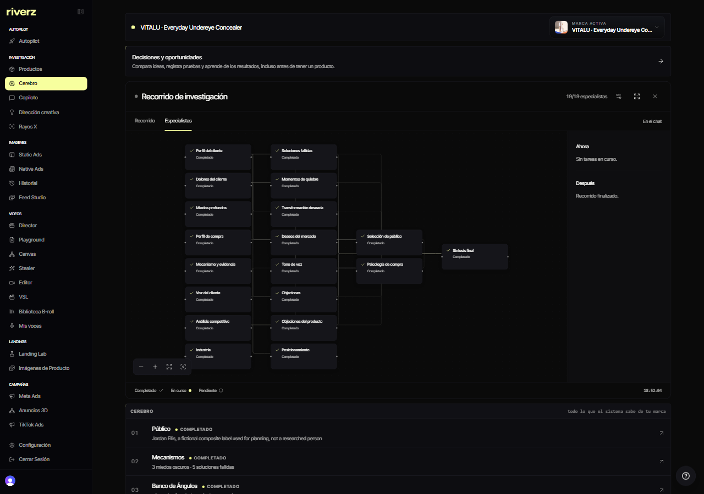
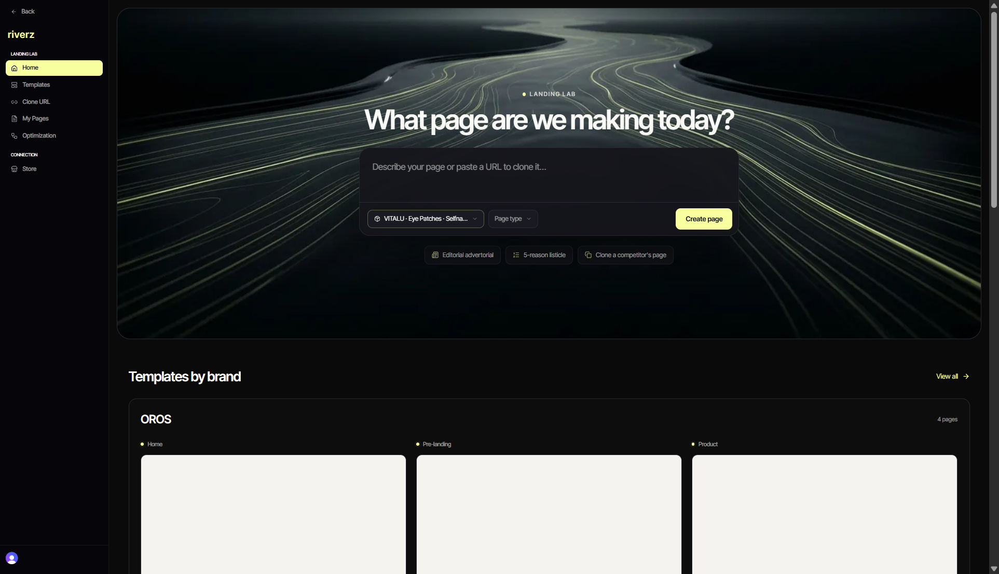
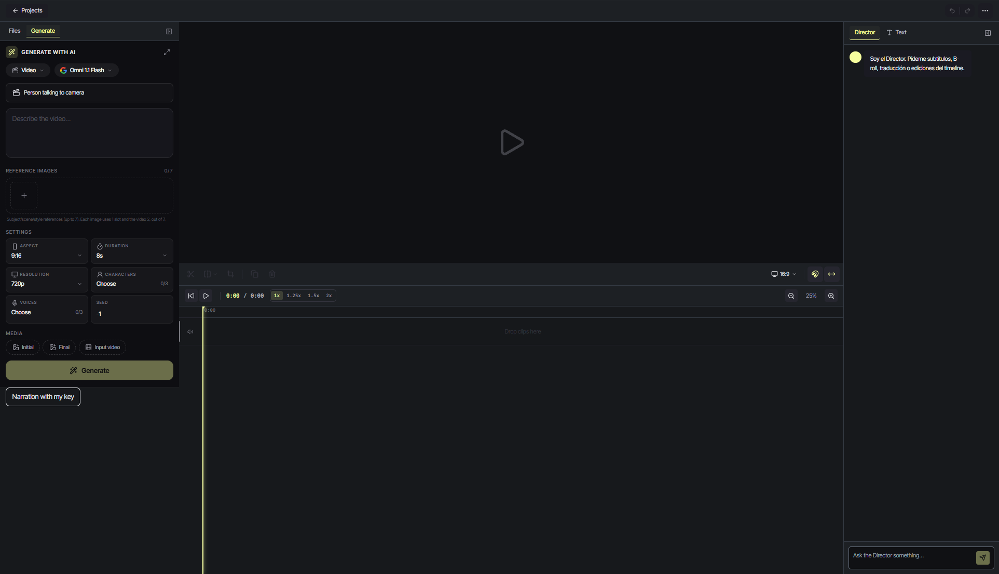
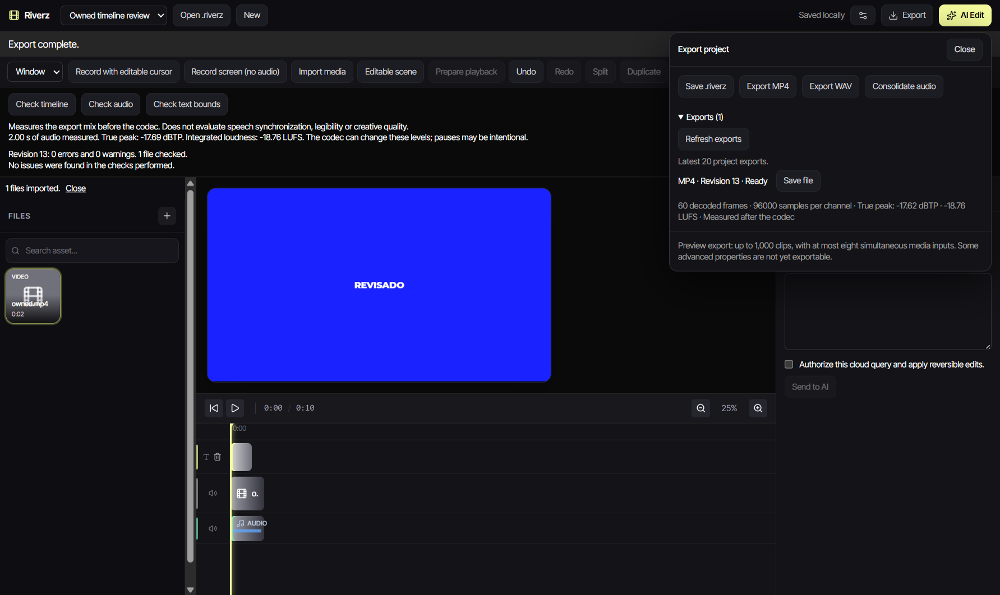
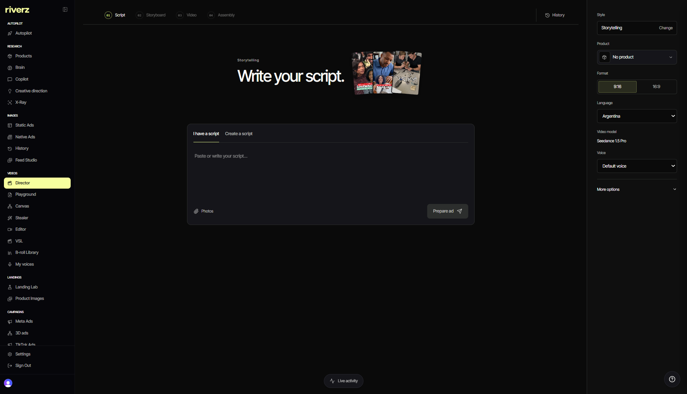

# Riverz AI

**Research, creative production and commerce tools for ecommerce teams.**

[Product](https://riverzai.com) · [Capabilities](CAPABILITIES.md) · [Engineering](ENGINEERING.md) · [Component cases](CASES.md) · [Screenshots](SCREENSHOTS.md)

Riverz connects product and market research with creative concepts, generated media, video editing and landing-page workflows. Research, Director, the editor, integrations and the Windows preview are parts of this one product.

## Inside the application

### Product research

Archived application capture, October 27, 2026; native Spanish/dark interface with a fictional planning persona. This shows the recorded research workflow.

### Landing Lab

Actual application capture, November 3, 2026; native English/dark interface. This is the page-creation workspace, before generating a page.

Video editor and additional interface captures

### Web video editor

Actual web capture, November 3, 2026; empty project.

### Windows development preview

Archived native QA capture, October 2, 2026; English/dark interface with synthetic test media. This is a development preview.

### Director script workspace

Actual web capture, November 3, 2026; native English/dark interface with an empty script.

## My contribution

I develop application workflows, the web interface, project persistence, media processing and external-service integrations. My work also includes the Windows desktop development preview with local editing and optional synchronization.

The [engineering cases](CASES.md) cover source-aware research, editorial timing, reversible editing, account permissions and project recovery. [The product map](CAPABILITIES.md) covers Landing Lab, CRO, product-image and marketing work, including operating limits.

**TypeScript · React · Next.js · PostgreSQL/Supabase · Clerk · Electron · SQLite · FFmpeg**

**All my development work presented here was done with AI assistance.** I define requirements, review code, test behavior and take responsibility for technical decisions, using programming and software engineering fundamentals.

Application source is private. The web application requires an account; the Windows version is a development preview.
