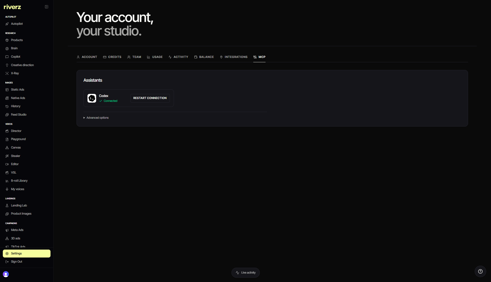

# Riverz AI · Assistant integrations

**Connecting external assistants to permitted Riverz operations.**

[Product overview](https://github.com/excelenciaempire/riverz-showcase) · [Engineering](ENGINEERING.md) · [Contact](https://github.com/excelenciaempire/riverz-showcase/issues/new?title=Professional%20inquiry)

This case describes one component of Riverz AI.

## Inside the application

### Assistant connection settings

Live application, November 3, 2026; native English/dark interface. Connection status is visible; advanced credential settings stay closed.

[Capture provenance](SCREENSHOTS.md)

## My contribution

I work on connection flows, authenticated identity, account permissions, tool access and recovery for research, creative work and editing.

## A technical decision

The acting team member and the shared account remain separate identities. Access to shared account data does not grant control of another member's local computer. [Read more](ENGINEERING.md).

**TypeScript · OAuth · MCP · Clerk · PostgreSQL**

**All my development work presented here was done with AI assistance.** I use programming and software engineering fundamentals to define requirements, review code, test behavior and take responsibility for technical decisions.

This repository contains an implementation summary; application source remains private.
