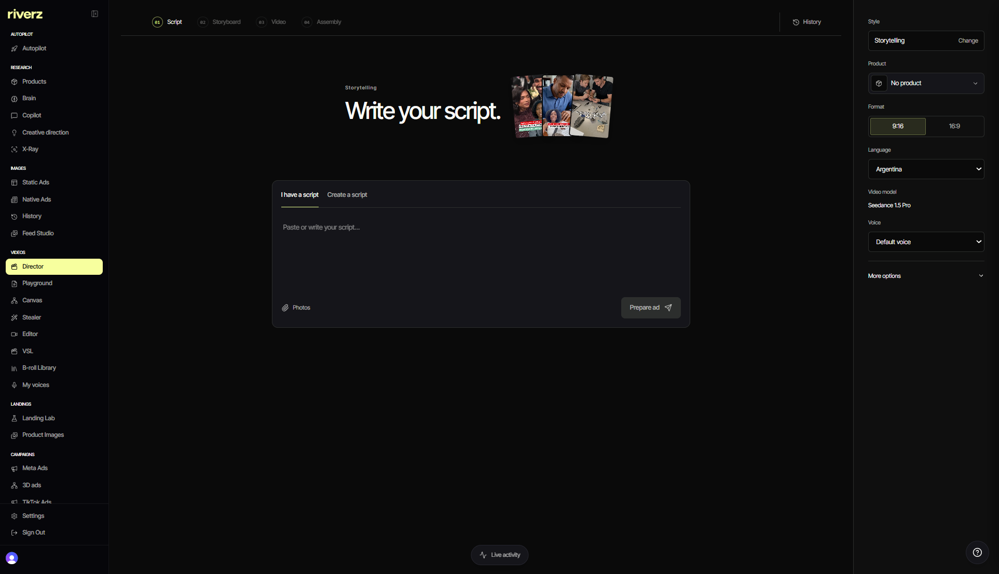

# Riverz AI · Creative generation

**From product context and creative concepts to generated media and an editable plan.**

[Product overview](https://github.com/excelenciaempire/riverz-showcase) · [Engineering](ENGINEERING.md) · [Contact](https://github.com/excelenciaempire/riverz-showcase/issues/new?title=Professional%20inquiry)

This case describes one component of Riverz AI.

## Inside the application

### Director script workspace

Live web application, November 3, 2026; native English/dark interface. The script is empty and generation has not been run.

[Capture provenance](SCREENSHOTS.md)

## My contribution

I work on concept planning, shot intent, review, generation requests and placing media results in the editor.

## A technical decision

Editorial duration stays separate from the duration sold by a media provider. A 4.25-second cut must retain that intent even when generation requires a longer legal duration. [Read more](ENGINEERING.md).

**TypeScript · Next.js · Background workers · FFmpeg · External media APIs**

**All my development work presented here was done with AI assistance.** I use programming and software engineering fundamentals to define requirements, review code, test behavior and take responsibility for technical decisions.

This repository contains an implementation summary; application source remains private.
