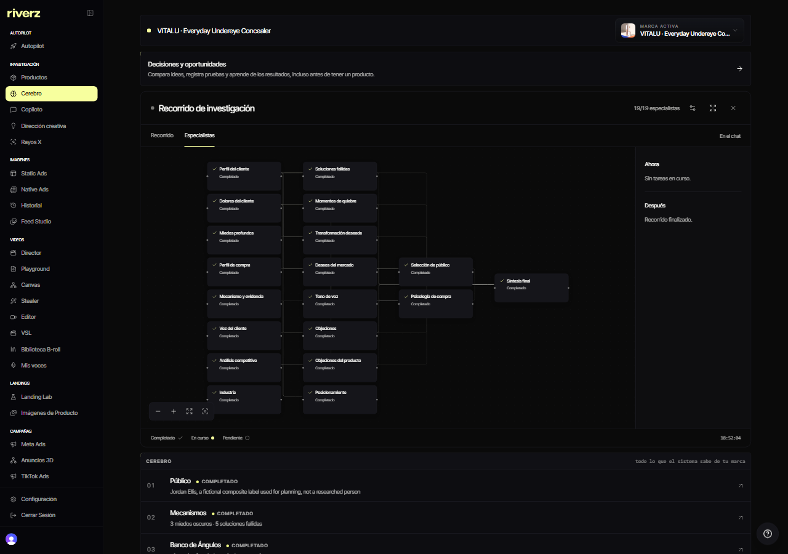
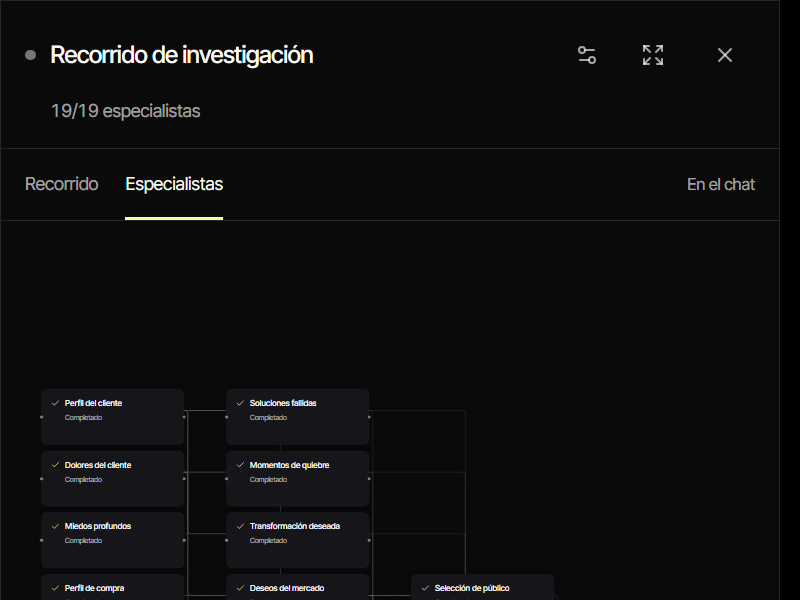

# Riverz AI · Product and market research

**Collecting sources and turning them into reviewable product hypotheses.**

[Product overview](https://github.com/excelenciaempire/riverz-showcase) · [Engineering](ENGINEERING.md) · [Contact](https://github.com/excelenciaempire/riverz-showcase/issues/new?title=Professional%20inquiry)

This case describes one component of Riverz AI.

## Inside the application

### Research workflow graph

Archived application capture, October 27, 2026; native Spanish/dark interface. The graph shows the recorded research workflow, not a newly run benchmark or a business result.

### Compact research graph

Archived fullscreen graph viewport, October 27, 2026; native Spanish/dark interface.

[Capture provenance](SCREENSHOTS.md)

## My contribution

I work on the shared research workflow, source capture, review, persistence and the handoff into creative planning.

## A technical decision

Research retains captured sources, citation IDs and unresolved questions. Failed searches remain observation failures rather than becoming evidence that demand does not exist. [Read more](ENGINEERING.md).

**TypeScript · Next.js · PostgreSQL · Search integrations · Background workflows**

**All my development work presented here was done with AI assistance.** I use programming and software engineering fundamentals to define requirements, review code, test behavior and take responsibility for technical decisions.

This repository contains an implementation summary; application source remains private.
