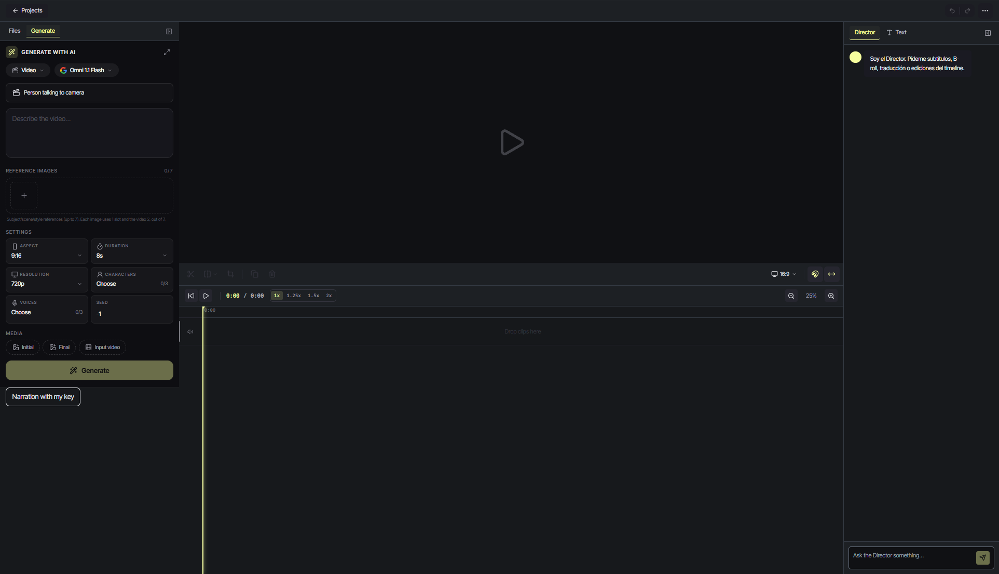
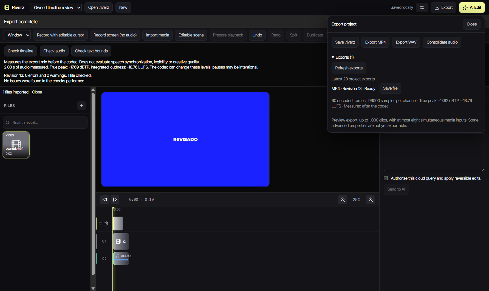

# Riverz AI · Video editor

**Timeline editing with reversible media operations.**

[Product overview](https://github.com/excelenciaempire/riverz-showcase) · [Engineering](ENGINEERING.md) · [Contact](https://github.com/excelenciaempire/riverz-showcase/issues/new?title=Professional%20inquiry)

This case describes one component of Riverz AI.

*Original web-editor capture, November 3, 2026; empty project. [Capture details](SCREENSHOTS.md).*

## Inside the application

### Windows editor development preview

Archived native development validation, October 2, 2026; English/dark interface with synthetic test media. This is a QA project, not a customer edit or proof of a current signed installer.

[Capture provenance](SCREENSHOTS.md)

## My contribution

I work on the editing command model, timeline behavior, media processing, persistence and shared web/desktop behavior.

## A technical decision

Separating a clip's audio preserves timing and sound settings as one undoable change. Explicit pair identities keep restore from deleting unrelated audio, and revision checks protect newer edits. [Read more](ENGINEERING.md).

**TypeScript · React · Next.js · Electron · SQLite · FFmpeg**

**All my development work presented here was done with AI assistance.** I use programming and software engineering fundamentals to define requirements, review code, test behavior and take responsibility for technical decisions.

This repository contains an implementation summary; application source remains private.
