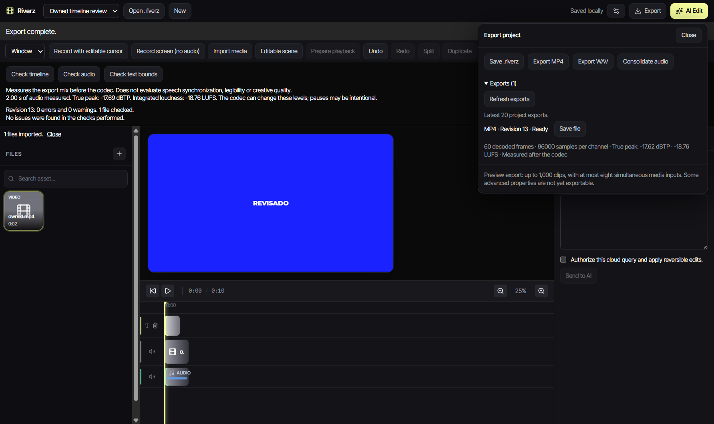

# Riverz AI · Windows desktop

**Local video editing with independent project windows and optional synchronization.**

[Product overview](https://github.com/excelenciaempire/riverz-showcase) · [Engineering](ENGINEERING.md) · [Contact](https://github.com/excelenciaempire/riverz-showcase/issues/new?title=Professional%20inquiry)

This case describes one component of Riverz AI.

## Inside the application

### Windows editor development preview

Archived native development validation, October 2, 2026; English/dark interface with synthetic test media. This is a QA project, not a customer edit or proof of a current signed installer.

[Capture provenance](SCREENSHOTS.md)

## My contribution

I work on the Electron runtime, shared editor components, local persistence, account connection and project synchronization.

## A technical decision

When local and web projects both change, synchronization preserves the divergent versions. Sync is optional and binds to the verified account and acting user. [Read more](ENGINEERING.md).

**Electron · TypeScript · React · SQLite · FFmpeg · Windows**

**All my development work presented here was done with AI assistance.** I use programming and software engineering fundamentals to define requirements, review code, test behavior and take responsibility for technical decisions.

This repository contains an implementation summary; application source remains private. The Windows app is a development preview.
